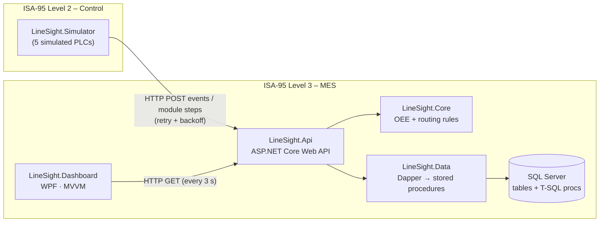
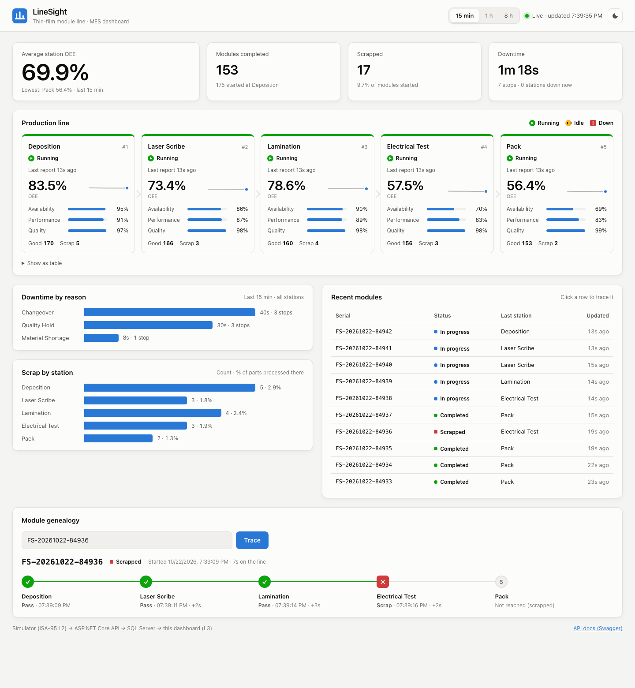
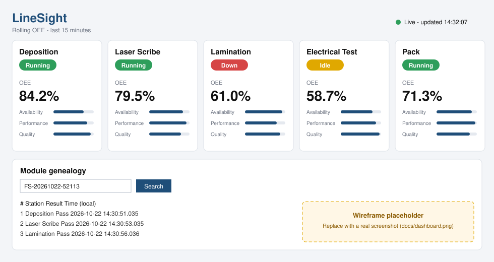

# LineSight – a mini MES for a thin-film solar module line

[](https://github.com/Shivom2110/LineSight/actions/workflows/build.yml)

LineSight is a small Manufacturing Execution System (MES) for a simulated 5-station thin-film
solar module line (Deposition → Laser Scribe → Lamination → Electrical Test → Pack). A simulated
PLC layer reports machine state, good/scrap counts and module serial numbers. LineSight stores
them in SQL Server and answers two core questions for a factory: **how well is each station
running?** (OEE = Availability × Performance × Quality, plus a downtime breakdown) and **where
has this module been?** (serialized genealogy / WIP traceability with timestamps, with strict
station order and a scrapped module never continuing). A WPF dashboard shows it all live.

## Architecture



This is a three-tier design: **WPF client → ASP.NET Core Web API → SQL Server**. The dashboard
never talks to the database directly.

| Project | Responsibility |
|---|---|
| `LineSight.Core` | Domain models, OEE math, routing/traceability rules, validation, repository interfaces, API contracts. No database, no UI. |
| `LineSight.Data` | SQL Server implementation of the repository interfaces (Dapper). Every call is a stored procedure. |
| `LineSight.Api` | REST endpoints, input validation, HTTP status mapping, DI, Swagger. |
| `LineSight.Simulation` | The simulated line itself (pure logic): station states, WIP buffers, breakdowns, scrap, serials. |
| `LineSight.Simulator` | Console app that runs the simulated line and sends its data to the API over HTTP (retry + backoff). |
| `LineSight.Dashboard` | WPF app (XAML + MVVM with CommunityToolkit.Mvvm): live station cards and a genealogy search. |
| `LineSight.Api/wwwroot` | Browser dashboard (plain HTML/CSS/JS, no build step) served by the API, using the same REST endpoints. |
| `tests/LineSight.Tests` | 108 xUnit tests (Core logic, simulator logic, and the API in memory with fake repositories). |

### Why is the OEE math split between SQL and C#?

- **SQL (`usp_GetStationOEE`) does the aggregation.** It turns thousands of event rows into
  run time, planned time and counts with set-based window functions (`LEAD`/`LAG`), right next
  to the data. Only one small row crosses the network.
- **C# (`OeeCalculator`) does the business formula.** It is unit-tested (divide-by-zero,
  rounding, the >100% performance flag) and runs without a database.
- The procedure also returns A/P/Q/OEE, for reports that query SQL directly (SSRS, Power BI).
  The API recomputes them in C# so there is one tested source of truth.

## Tech stack

- C# 12 / **.NET 8** in every project
- **ASP.NET Core Web API** (controllers, DI, async/await, ProblemDetails, Swagger)
- **SQL Server** (LocalDB or Docker) with **T-SQL stored procedures**, called through **Dapper**
- **WPF** with **XAML + MVVM** (CommunityToolkit.Mvvm: `ObservableObject`, `[ObservableProperty]`, `[RelayCommand]`)
- **xUnit** (written test-first), `WebApplicationFactory` for in-memory API tests
- **GitHub Actions** (YAML) CI on `windows-latest`

## Domain rules

**Station state.** Each station reports `Running`, `Idle` or `Down`. Down requires a downtime
reason (Material Shortage, Equipment Fault, Changeover, Quality Hold), and a reason is only
allowed while Down. The rule is enforced in C# and again by a SQL `CHECK` constraint.

**Module routing.** Serials look like `FS-yyyyMMdd-NNNNN`.
- A module is created at Deposition and must visit every station strictly in order.
- Skipping a station, repeating one, reusing a serial or using an unknown station is rejected.
- A module stops for good once it is scrapped, or completed at Pack.

### OEE

```
Availability = RunTime / PlannedProductionTime
Performance  = (IdealCycleTime × TotalCount) / RunTime
Quality      = GoodCount / TotalCount
OEE          = Availability × Performance × Quality
```

- Any divide-by-zero returns 0 instead of throwing. "Nothing happened in this window" is normal on a dashboard.
- OEE is multiplied from the **unrounded** factors and rounded once, to 4 decimals.
- Performance above 100% is calculated, not capped, and **flagged** in the API response. It
  almost always means the station's ideal cycle time is configured wrong.
- **Time accounting.** Each machine event owns the time until the next event. A gap longer than
  10 s means the station was offline, so it counts as neither run time nor downtime.
  - Planned production time is all the time covered by events.
  - Run time is the time covered by `Running` events.
- Downtime is summed per reason. *Occurrences* counts episodes (entering Down, or the reason
  changing while Down), not individual events.

## API

| Method & route | Purpose | Errors |
|---|---|---|
| `POST /api/events` | Record a machine event | 400 on an invalid payload, Down without a reason, or an unknown station |
| `POST /api/modules/{serial}/steps` | Record a module passing or being scrapped at a station | 400 on a bad serial or unknown station; 409 on a skipped station, scrapped/completed module or duplicate serial |
| `GET /api/stations` | All stations with their current state | |
| `GET /api/oee/{stationId}?from=&to=` | OEE breakdown and downtime reasons (default window: the last hour) | 400 on a bad window, 404 on an unknown station |
| `GET /api/simulation` | Status of the simulator built into the API | |
| `POST /api/simulation/start?minutes=10` | Start the built-in simulator (stops itself after 1–60 min; calling again extends it) | 400 if minutes is out of range |
| `POST /api/simulation/stop` | Stop the built-in simulator | |
| `GET /api/modules?take=20` | Most recent modules with their last station | 400 if take isn't between 1 and 100 |
| `GET /api/modules/{serial}` | Module genealogy, in station order | 404 if the serial isn't found |

Swagger UI: <http://localhost:5080/swagger>

## How to run

Prerequisites: [.NET 8 SDK](https://dotnet.microsoft.com/download/dotnet/8.0), and SQL Server
LocalDB (it ships with Visual Studio) **or** Docker. The dashboard needs Windows. The API,
simulator and tests also run on macOS and Linux.

### 1. Create the database

**Option A – LocalDB (Windows, default connection string):**

```powershell
sqllocaldb start MSSQLLocalDB
sqlcmd -S "(localdb)\MSSQLLocalDB" -i database\schema.sql
sqlcmd -S "(localdb)\MSSQLLocalDB" -i database\procedures.sql
```

**Option B – SQL Server in Docker:**

```bash
docker compose up -d        # wait ~20 s for SQL Server to start
docker exec -i linesight-sql /opt/mssql-tools18/bin/sqlcmd -C -S localhost -U sa -P 'LineSight!Passw0rd' < database/schema.sql
docker exec -i linesight-sql /opt/mssql-tools18/bin/sqlcmd -C -S localhost -U sa -P 'LineSight!Passw0rd' < database/procedures.sql

# then point the API at it (PowerShell: $env:ConnectionStrings__LineSight = "...")
export ConnectionStrings__LineSight='Server=localhost,1433;Database=LineSight;User Id=sa;Password=LineSight!Passw0rd;TrustServerCertificate=True'
```

`schema.sql` drops and recreates the tables, so rerunning it resets all data.

### 2. Start the API

```bash
dotnet run --project src/LineSight.Api --launch-profile http     # http://localhost:5080/swagger
```

### 3. Feed it data: the simulator (the PLC layer)

**Easiest:** open the dashboard (step 4) and click **▶ Start simulation**. The API runs the simulated
line itself for 10 minutes. It writes through the same repositories and routing rules as the HTTP
endpoints, then stops on its own.

**Or** run the standalone console simulator. It talks to the API over HTTP like real PLC gateways would,
with retry and backoff. Use one or the other, not both at once, because both number new serials the
same way and would clash.

```bash
dotnet run --project src/LineSight.Simulator
# override settings, e.g.:
dotnet run --project src/LineSight.Simulator -- --Simulator:TickIntervalMs=500 --Simulator:ScrapRate=0.05
```

Settings live in `src/LineSight.Simulator/appsettings.json`: `ApiBaseUrl`, `TickIntervalMs`,
`ScrapRate`, `DownChancePerTick`, `BufferCapacity` and `Seed`. Try stopping the API while the
simulator runs: it queues messages, retries with exponential backoff (1 s, 2 s, 4 s … up to
30 s) and catches up without losing an event.

### 4. Open the web dashboard (any OS)

The API also serves a browser dashboard. Once the API is running, open **<http://localhost:5080>**.
It shows:
- live station states and OEE (A/P/Q) with trend sparklines
- downtime and scrap charts
- the most recent modules
- a genealogy timeline: click a module, or deep-link with `/?serial=FS-…`

Window picker: 15 min, 1 h or 8 h. Light and dark themes.



### 5. Start the WPF dashboard (Windows)

```powershell
dotnet run --project src/LineSight.Dashboard
# different API address:  $env:LINESIGHT_API_URL = "http://otherhost:5080"
```


<!-- Screenshot placeholder (wireframe of the real layout). Run the dashboard with the simulator going,
     save a capture as docs/dashboard.png and point the image link above at it. -->

## Tests

```bash
dotnet test
```

There are 108 tests and none of them need a database: Core logic is tested directly, and the API
is hosted in memory with `WebApplicationFactory`, with the SQL repositories swapped for
in-memory fakes. Coverage includes:
- **OEE:** each factor on its own, normal, perfect, zero run time, zero count, all scrap, the >100% flag, rounding and precision
- **Traceability:** correct order, skipped station, duplicate serial, unknown station, scrapped or completed module, genealogy order, serial format
- **Validation and API:** Down without a reason, bad payloads (400), unknown station/module (404), routing conflicts (409)
- **Simulator:** backoff, retry without data loss, no retry on 4xx, and generated module flow replayed through the real routing rules
- **Built-in simulation:** start, stop, extend, auto-stop after the time limit (using `FakeTimeProvider`), and out-of-range durations

The work was done test-first. The git history shows each `test: add failing …` commit before the
`feat: implement …` commit that makes it pass (`git log --oneline`).

## Design notes worth knowing

- **Idempotent event ingestion.** If a request times out after the server has already saved it,
  the simulator retries. `usp_RecordMachineEvent` then returns the existing row for the same
  `(StationId, TimestampUtc)`, backed by a unique index, instead of double-counting parts.
- **The database is a backstop for the C# rules.** `CHECK` constraints mirror the downtime
  rule, and `UNIQUE (ModuleId, StationId)` stops a module visiting a station twice.
  - `usp_RecordModuleStep` uses a transaction with `UPDLOCK, HOLDLOCK`, plus TRY/CATCH and rollback.
- **Indexes match the queries.** The covering index `(StationId, TimestampUtc) INCLUDE (...)`
  serves both the OEE window scan and the "latest state per station" lookup (`OUTER APPLY TOP 1`).
- **UTC everywhere.** Values are stored as `DATETIME2(3)`, sent as ISO-8601 with `Z`, and the
  dashboard converts to local time only for display.

## Next steps

- **Real PLC connectivity over OPC UA:** subscribe to tags on the line's PLCs (e.g. with the
  OPC Foundation .NET Standard stack) instead of the simulator, and persist the outbound queue
  so data survives a gateway restart.
- **Operator downtime coding:** let operators confirm or re-classify downtime reasons and add
  comments from the floor.
- **Role-based access:** authentication (e.g. Entra ID / JWT), with roles for operator,
  engineer and read-only.
- **High event volume:** partition `MachineEvents` by month and archive old partitions; pre-aggregate hourly OEE.
- **Real-time push:** send updates to the dashboard with SignalR instead of polling.
- **Planned production time from a shift calendar,** so planned breaks don't count against Availability.
