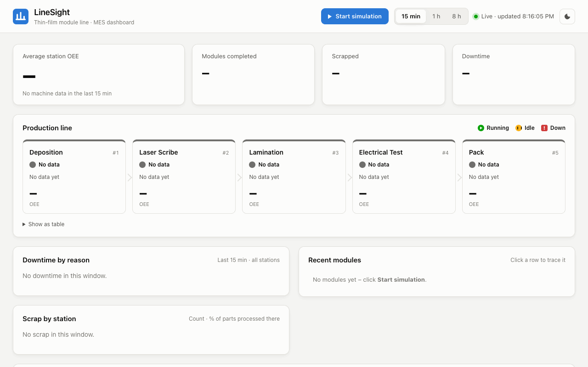
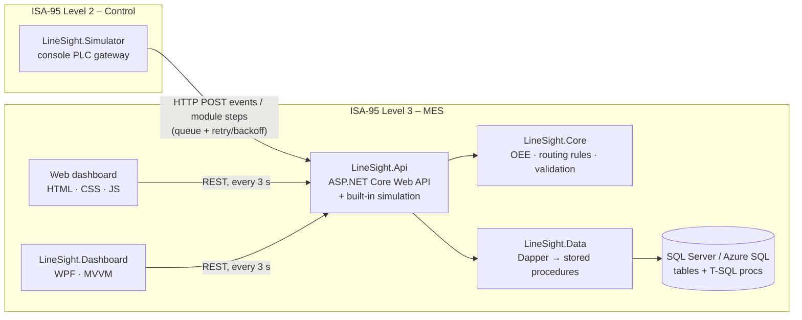

# LineSight – a mini MES for a thin-film solar module line

[](https://github.com/Shivom2110/LineSight/actions/workflows/build.yml)


**▶ Live demo: <https://linesight-shivom.azurewebsites.net>.** Click **Start simulation** and watch the line run.
*It's hosted on Azure's free tiers, so after a quiet period the first load can take 30–60 s while the app and database wake up.*

LineSight is a small **Manufacturing Execution System (MES)** for a simulated 5-station thin-film
solar module line (Deposition → Laser Scribe → Lamination → Electrical Test → Pack). Simulated PLCs
report machine state, good/scrap part counts and module serial numbers. LineSight stores them in
SQL Server and answers the two questions a production floor asks all day:

- **How well is each station running?** OEE = Availability × Performance × Quality, with downtime by reason.
- **Where has this module been?** Serialized genealogy and WIP traceability, with timestamps. Station
  order is strict, and a scrapped module can never continue.



*Click **Start simulation**: five simulated PLCs feed the MES. OEE, downtime and scrap update live, and
typing a serial number shows that module's genealogy, here passing two stations and then being scrapped at Lamination.*

## Highlights

| | |
|---|---|
| **3-tier architecture** | WPF client (and a browser dashboard) → ASP.NET Core 8 Web API → SQL Server. Clients never touch the database. |
| **SQL Server done properly** | T-SQL stored procedures for every data access: OEE aggregation with `LEAD`/`LAG` window functions, genealogy, transactional module steps. CHECK and UNIQUE constraints, covering indexes, idempotent inserts. |
| **Tested business logic** | OEE math, routing rules and validation live in a plain C# library with **120 xUnit tests**, written test-first (TDD). The git history shows each failing test before its implementation. |
| **Resilient PLC layer** | The simulator queues data and retries with exponential backoff, so an API outage delays data but loses nothing. |
| **Live on Azure** | App Service and Azure SQL (serverless). The app sets up its own database schema and rides out the database waking from a pause. |
| **CI/CD** | GitHub Actions builds and tests every push, then deploys `main` to Azure using **OIDC** (no stored secrets) and smoke-tests that the exact commit is live. |

## Architecture



| Project | Responsibility |
|---|---|
| `LineSight.Core` | Domain models, OEE math, routing/traceability rules, validation, repository interfaces, API contracts. No database or UI code, so it's fully unit-testable. |
| `LineSight.Data` | SQL Server implementation of the repository interfaces (Dapper). Every call is a stored procedure. Also embeds the `.sql` scripts and sets up the database on startup. |
| `LineSight.Api` | REST endpoints, validation, HTTP status mapping, DI, Swagger. Hosts the **built-in simulation** (Start/Stop button) and serves the **web dashboard** from `wwwroot/`. |
| `LineSight.Simulation` | The simulated line itself (pure logic): station states, WIP buffers, breakdowns, scrap, serial numbers. |
| `LineSight.Simulator` | Console app acting as the PLC gateway: runs the simulated line and sends its data over HTTP with retry and backoff. |
| `LineSight.Dashboard` | WPF desktop app (XAML + MVVM with CommunityToolkit.Mvvm): live station cards and a genealogy search. |
| `tests/LineSight.Tests` | 120 xUnit tests: Core logic, simulator logic, SQL script handling, and the API hosted in memory with fake repositories. |
| `database/` | `schema.sql` (tables, constraints, indexes, seed data) and `procedures.sql` (stored procedures). |

### Why is the OEE math split between SQL and C#?

- **SQL (`usp_GetStationOEE`) does the aggregation.** It turns thousands of event rows into run time,
  planned time and counts with set-based window functions, right next to the data. Only one small row
  crosses the network.
- **C# (`OeeCalculator`) does the business formula.** It is unit-tested (divide-by-zero, rounding,
  the >100% performance flag) and runs without a database.
- The procedure also returns A/P/Q/OEE, for reports that query SQL directly (SSRS, Power BI).
  The API recomputes them in C# so there is one tested source of truth.

## Tech stack

- **C# 12 / .NET 8** in every project
- **ASP.NET Core Web API**: controllers, dependency injection, async/await, ProblemDetails, Swagger, hosted background service
- **SQL Server** (LocalDB, Docker or Azure SQL) with **T-SQL stored procedures**, called through **Dapper**
- **WPF** with **XAML + MVVM** (CommunityToolkit.Mvvm: `ObservableObject`, `[ObservableProperty]`, `[RelayCommand]`)
- **Web dashboard** in plain HTML/CSS/JavaScript (no framework or build step), served by the API
- **xUnit**, written test-first; `WebApplicationFactory` for in-memory API tests; `FakeTimeProvider` for time-based tests
- **Azure**: App Service (Linux), Azure SQL Database (serverless), managed identity
- **GitHub Actions** (YAML) CI/CD with OIDC deployment to Azure

## Domain rules

**Station state.** Each station reports `Running`, `Idle` or `Down`. Down requires a downtime reason
(Material Shortage, Equipment Fault, Changeover, Quality Hold), and a reason is only allowed while Down.
The rule is enforced in C# and again by a SQL `CHECK` constraint.

**Module routing.** Serials look like `FS-yyyyMMdd-NNNNN`.
- A module is created at Deposition and must visit every station strictly in order.
- Skipping a station, repeating one, reusing a serial or using an unknown station is rejected.
- A module stops for good once it is scrapped, or completed at Pack.

### OEE

```
Availability = RunTime / PlannedProductionTime
Performance  = (IdealCycleTime × TotalCount) / RunTime
Quality      = GoodCount / TotalCount
OEE          = Availability × Performance × Quality
```

- Any divide-by-zero returns 0 instead of throwing. "Nothing happened in this window" is normal on a dashboard.
- OEE is multiplied from the **unrounded** factors and rounded once, to 4 decimals.
- Performance above 100% is calculated, not capped, and **flagged** in the API response. It almost
  always means the station's ideal cycle time is configured wrong.
- **Time accounting.** Each machine event owns the time until the next event. A gap longer than 10 s
  means the station was offline, so it counts as neither run time nor downtime.
  - Planned production time is all the time covered by events.
  - Run time is the time covered by `Running` events.
- Downtime is summed per reason. *Occurrences* counts episodes (entering Down, or the reason changing
  while Down), not individual events.

## API

Swagger UI: [live](https://linesight-shivom.azurewebsites.net/swagger) · local: <http://localhost:5080/swagger>

| Method & route | Purpose | Errors |
|---|---|---|
| `POST /api/events` | Record a machine event | 400 on an invalid payload, Down without a reason, or an unknown station |
| `POST /api/modules/{serial}/steps` | Record a module passing or being scrapped at a station | 400 on a bad serial or unknown station; 409 on a skipped station, scrapped/completed module or duplicate serial |
| `GET /api/stations` | All stations with their current state | |
| `GET /api/oee/{stationId}?from=&to=` | OEE breakdown and downtime reasons (default window: the last hour) | 400 on a bad window, 404 on an unknown station |
| `GET /api/modules?take=20` | Most recent modules with their last station | 400 if take isn't between 1 and 100 |
| `GET /api/modules/{serial}` | Module genealogy, in station order | 404 if the serial isn't found |
| `GET /api/simulation` | Status of the built-in simulation | |
| `POST /api/simulation/start?minutes=10` | Start the built-in simulation (stops itself after 1–60 min; calling again extends it) | 400 if minutes is out of range |
| `POST /api/simulation/stop` | Stop the built-in simulation | |
| `GET /api/version` | Which build is running (version and git commit) | |

## Run it locally

Prerequisites: [.NET 8 SDK](https://dotnet.microsoft.com/download/dotnet/8.0), and SQL Server LocalDB
(it ships with Visual Studio) **or** Docker. The WPF dashboard needs Windows. Everything else (API,
web dashboard, simulator and tests) also runs on macOS and Linux.

### 1. Create the database

**Option A – LocalDB (Windows, default connection string):**

```powershell
sqllocaldb start MSSQLLocalDB
sqlcmd -S "(localdb)\MSSQLLocalDB" -i database\schema.sql
sqlcmd -S "(localdb)\MSSQLLocalDB" -i database\procedures.sql
```

**Option B – SQL Server in Docker:**

```bash
docker compose up -d        # wait ~20 s for SQL Server to start
docker exec -i linesight-sql /opt/mssql-tools18/bin/sqlcmd -C -S localhost -U sa -P 'LineSight!Passw0rd' < database/schema.sql
docker exec -i linesight-sql /opt/mssql-tools18/bin/sqlcmd -C -S localhost -U sa -P 'LineSight!Passw0rd' < database/procedures.sql

# then point the API at it (PowerShell: $env:ConnectionStrings__LineSight = "...")
export ConnectionStrings__LineSight='Server=localhost,1433;Database=LineSight;User Id=sa;Password=LineSight!Passw0rd;TrustServerCertificate=True'
```

`schema.sql` drops and recreates the tables, so rerunning it resets all data.

### 2. Start the API

```bash
dotnet run --project src/LineSight.Api --launch-profile http
```

### 3. Open the web dashboard and start the line

Open **<http://localhost:5080>** and click **▶ Start simulation**. The API runs the simulated line for
10 minutes, writing through the same repositories and routing rules as the HTTP endpoints, then stops
on its own. The dashboard shows:
- live station states and OEE (A/P/Q) with trend sparklines
- downtime and scrap charts
- the most recent modules
- a genealogy timeline: click a module, or deep-link with `/?serial=FS-…`

Window picker: 15 min, 1 h or 8 h. Light and dark themes.


### 4. Optional: the standalone PLC simulator

Instead of the built-in simulation, you can run the console simulator. It talks to the API over HTTP
the way a real PLC gateway would. Use one or the other, not both at once, because both number new
serials the same way and would clash.

```bash
dotnet run --project src/LineSight.Simulator
# override settings, e.g.:
dotnet run --project src/LineSight.Simulator -- --Simulator:TickIntervalMs=500 --Simulator:ScrapRate=0.05
```

Settings live in `src/LineSight.Simulator/appsettings.json`: `ApiBaseUrl`, `TickIntervalMs`, `ScrapRate`,
`DownChancePerTick`, `BufferCapacity` and `Seed`. Try stopping the API while it runs: the simulator
queues messages, retries with exponential backoff (1 s, 2 s, 4 s … up to 30 s) and catches up without
losing an event.

### 5. Optional: the WPF dashboard (Windows)

```powershell
dotnet run --project src/LineSight.Dashboard
# different API address:  $env:LINESIGHT_API_URL = "https://linesight-shivom.azurewebsites.net"
```


<!-- Wireframe of the real WPF layout. Run the dashboard on Windows, save a capture as
     docs/dashboard.png and point the image link above at it. -->

## Tests

```bash
dotnet test
```

There are 120 tests and none of them need a database: Core logic is tested directly, and the API is
hosted in memory with `WebApplicationFactory`, with the SQL repositories swapped for in-memory fakes.
Coverage includes:
- **OEE:** each factor on its own, normal, perfect, zero run time, zero count, all scrap, the >100% flag, rounding and precision
- **Traceability:** correct order, skipped station, duplicate serial, unknown station, scrapped or completed module, genealogy order, serial format
- **Validation and API:** Down without a reason, bad payloads (400), unknown station/module (404), routing conflicts (409), recent modules, version
- **Simulator:** backoff, retry without data loss, no retry on 4xx, and generated module flow replayed through the real routing rules
- **Built-in simulation:** start, stop, extend, and auto-stop after the time limit (using `FakeTimeProvider`)
- **Database scripts:** splitting on `GO`, skipping `USE`/`CREATE DATABASE` batches, and the embedded scripts

The work was done test-first. The git history shows each `test: add failing …` commit before the
`feat: …` commit that makes it pass (`git log --oneline`).

## CI/CD

[`.github/workflows/build.yml`](.github/workflows/build.yml) runs on every push and pull request:

1. **build-and-test** (`windows-latest`): restore, build (Release), run all tests, then publish the API
   once and save it as a build artifact.
2. **deploy** (pushes to `main` only, and only if the tests passed):
   - Signs in to Azure with **OIDC**, so no password or publish profile is stored in GitHub. A
     user-assigned managed identity trusts only this repository's `production` environment, and it can
     only deploy to this one web app (Website Contributor role).
   - Deploys the **same artifact that was tested**.
   - **Smoke test:** waits until the live [`/api/version`](https://linesight-shivom.azurewebsites.net/api/version)
     reports the commit just pushed, then checks that the API can reach the database. If the new build
     never comes up, the deploy fails.

The live build is also shown in the dashboard footer.

## Deployment (Azure)

The live demo runs on **Azure App Service** (Linux, .NET 8, Free F1 plan) with **Azure SQL Database**
(serverless, free offer) in `canadacentral`.

- **No manual SQL step.** With `Database__InitializeOnStartup=true`, the app creates the schema on an
  empty database and re-applies `procedures.sql` (`CREATE OR ALTER`) on every start, so the stored
  procedures always match the deployed code. Existing tables are never dropped. The `.sql` files are
  embedded in `LineSight.Data`.
- **Built for a database that pauses.** The serverless database pauses when idle. SqlClient's exponential
  retry (`SqlConnectionFactory`) rides out error 40613 while it resumes, so the first request is slow
  instead of failing.
- **Secrets stay out of the repo.** The connection string is an App Service connection-string setting,
  the database firewall only admits Azure services, and the site is HTTPS-only.

One-time setup (deploys after that are automatic, via CI/CD):

```bash
az group create -n rg-linesight -l canadacentral
az sql server create -g rg-linesight -n <sql-server> --admin-user <admin> --admin-password <password>
az sql db create -g rg-linesight -s <sql-server> -n LineSight --edition GeneralPurpose --compute-model Serverless \
  --family Gen5 --capacity 2 --use-free-limit --free-limit-exhaustion-behavior AutoPause
az sql server firewall-rule create -g rg-linesight -s <sql-server> -n AllowAzureServices --start-ip-address 0.0.0.0 --end-ip-address 0.0.0.0
az appservice plan create -g rg-linesight -n plan-linesight --is-linux --sku F1
az webapp create -g rg-linesight -p plan-linesight -n <app-name> --runtime "DOTNETCORE:8.0"
az webapp config connection-string set -g rg-linesight -n <app-name> --connection-string-type SQLAzure --settings LineSight="<connection string>"
az webapp config appsettings set -g rg-linesight -n <app-name> --settings Database__InitializeOnStartup=true
az webapp config set -g rg-linesight -n <app-name> --startup-file "dotnet LineSight.Api.dll"

# identity that GitHub Actions signs in as (OIDC)
az identity create -g rg-linesight -n id-linesight-github
az identity federated-credential create -g rg-linesight --identity-name id-linesight-github -n github-production-env \
  --issuer https://token.actions.githubusercontent.com --audiences api://AzureADTokenExchange \
  --subject "<the subject GitHub presents, e.g. repo:<owner>@<owner-id>/<repo>@<repo-id>:environment:production>"
az role assignment create --assignee-object-id <identity principalId> --assignee-principal-type ServicePrincipal \
  --role "Website Contributor" --scope <web app resource id>
# then add AZURE_CLIENT_ID, AZURE_TENANT_ID and AZURE_SUBSCRIPTION_ID as GitHub repository secrets
```

## Design notes worth knowing

- **Idempotent event ingestion.** If a request times out after the server has already saved it, the
  simulator retries. `usp_RecordMachineEvent` then returns the existing row for the same
  `(StationId, TimestampUtc)`, backed by a unique index, instead of double-counting parts.
- **The database is a backstop for the C# rules.** `CHECK` constraints mirror the downtime rule, and
  `UNIQUE (ModuleId, StationId)` stops a module visiting a station twice.
  - `usp_RecordModuleStep` uses a transaction with `UPDLOCK, HOLDLOCK`, plus TRY/CATCH and rollback.
- **Indexes match the queries.** The covering index `(StationId, TimestampUtc) INCLUDE (...)` serves
  both the OEE window scan and the "latest state per station" lookup (`OUTER APPLY TOP 1`).
- **A demo that can't run away.** The built-in simulation always stops itself (default 10 min, max 60)
  so a forgotten tab can't burn through the free cloud database allowance.
- **UTC everywhere.** Values are stored as `DATETIME2(3)`, sent as ISO-8601 with `Z`, and the dashboards
  convert to local time only for display.

## Next steps

- **Real PLC connectivity over OPC UA:** subscribe to tags on the line's PLCs (e.g. with the OPC
  Foundation .NET Standard stack) instead of the simulator, and persist the outbound queue so data
  survives a gateway restart.
- **Operator downtime coding:** let operators confirm or re-classify downtime reasons and add comments
  from the floor.
- **Role-based access:** authentication (e.g. Entra ID / JWT), with roles for operator, engineer and
  read-only. Today the demo endpoints, including Start/Stop simulation, are open.
- **.NET 10:** .NET 8 support ends in November 2026; moving to .NET 10 LTS is a target-framework change.
- **Staging slot:** deploy to a staging slot first and swap it in after the smoke test, for zero-downtime
  releases (needs a paid App Service tier).
- **High event volume:** partition `MachineEvents` by month and archive old partitions; pre-aggregate hourly OEE.
- **Real-time push:** send updates to the dashboards with SignalR instead of polling.
- **Planned production time from a shift calendar,** so planned breaks don't count against Availability.
